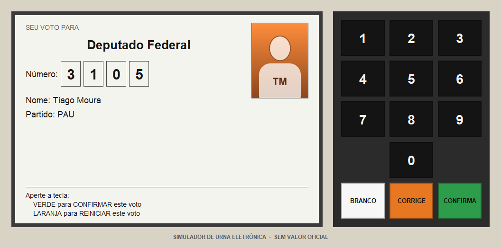

# Urna Eletrônica em Java

Simulador de urna eletrônica **sem valor oficial**, feito para estudo. Aplicação desktop
escrita só em Java: interface em **Swing**, arquitetura **MVC com Fachada** e votos gravados
no **Supabase (PostgreSQL)** via **JDBC**. A votação segue a ordem Deputado Federal,
Deputado Estadual, Senador, Governador e Presidente, com as teclas BRANCO, CORRIGE e
CONFIRMA e os sons de tecla, confirmação e fim.

Todos os partidos, candidatos e fotos são fictícios.



## Como abrir

Requisito: Java 17 ou superior.

| No Windows | Comando | Abre | Dados |
|---|---|---|---|
| `Abrir Urna.cmd` | `java -jar urna.jar` | urna de votação | Supabase (role `urna_votacao`) |
| `Abrir Administracao.cmd` | `java -jar urna.jar administracao` | cadastro e apuração | Supabase (role `urna_administracao`) |
| — | `java -jar urna.jar demonstracao` | urna e administração juntas | memória, sem internet |

Sem configuração do banco, ou se o banco não responder, a urna oferece os dados de
demonstração. Teclado do computador: dígitos, **Enter** = CONFIRMA, **Backspace** = CORRIGE.

Números para testar: Deputado Federal `3105`, Deputado Estadual `31042`, Senador `312`,
Governador `31`, Presidente `47`. Um número com partido inexistente (por exemplo `99`) dá
NÚMERO ERRADO; com partido existente e sem candidato (por exemplo `3199`) dá CANDIDATO INEXISTENTE.

## Configurar o Supabase

1. Crie um projeto no [Supabase](https://supabase.com).
2. No **SQL Editor**, rode em ordem `banco/01-esquema.sql`, `banco/02-seguranca.sql` (troque
   antes as duas senhas `TROQUE-ESTA-SENHA`) e `banco/03-dados-ficticios.sql`.
3. Crie o arquivo `urna.propriedades` na pasta do projeto, a partir de
   `src/main/resources/urna.propriedades.exemplo`, com o endereço do **Session pooler**
   (botão *Connect*, porta 5432) e os usuários `urna_votacao.<referencia-do-projeto>` e
   `urna_administracao.<referencia-do-projeto>`. Esse arquivo fica fora do Git.

## Compilar e testar

```bash
mvnw.cmd verify
```

Compila, roda os testes JUnit 5, confere a cobertura mínima de 80% no modelo e no negócio e
gera `target/urna.jar`. Copie esse arquivo para a raiz para usar com os atalhos.
`mvnw.cmd javadoc:javadoc` gera a documentação da API.

Se o Maven falhar com `PKIX path building failed` (antivírus inspecionando HTTPS), rode antes:
`$env:MAVEN_OPTS = "-Djavax.net.ssl.trustStoreType=Windows-ROOT"`.

## Estrutura

```
src/main/java/br/com/urna/
├── Aplicacao.java          ponto de entrada: monta e liga as peças
├── modelo/                 Cargo, Partido, Candidato (+3 subclasses), Voto (+3 subclasses),
│                           ApuracaoCargo e SessaoVotacao
├── negocio/                FachadaUrna: única porta de entrada das regras
├── persistencia/           RepositorioUrna, implementações Supabase e memória, ConexaoBancoDados
├── controle/               ControladorVotacao, ControladorAdministracao, VisaoVotacao
├── visao/                  janelas, painéis e teclas Swing
├── som/                    ReprodutorSom
└── excecao/                UrnaException
```

A visão chama o controle, o controle chama a `FachadaUrna`, a Fachada usa o repositório, e o
modelo não depende de ninguém.

## Documentação

- [docs/Documentacao-Tecnica-Urna.pdf](docs/Documentacao-Tecnica-Urna.pdf): todas as classes,
  métodos, fluxos e a ligação com o banco.
- [docs/roteiro-apresentacao.md](docs/roteiro-apresentacao.md): roteiro de 15 minutos.
- [docs/checklist-inspecao.md](docs/checklist-inspecao.md): evidência de cada item do checklist.
- [docs/uml/](docs/uml/) e [docs/decisoes/](docs/decisoes/): diagramas e decisões.

## Limitações

- O voto não guarda eleitor nem horário, mas os cinco votos de um eleitor entram juntos no banco.
- Quem tiver a senha da role `urna_votacao` consegue inserir votos (não ler nem apagar).
- Fora do escopo: identificação do eleitor, voto de legenda, segundo turno.
